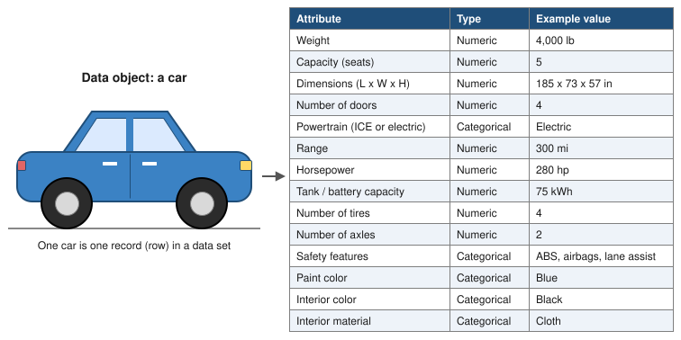

---
format:
  pdf:
    documentclass: article
    papersize: letter
    fontsize: 12pt
    geometry:
      - margin=1in
    include-in-header: preamble.tex
---

```{=latex}
% Fill these in once per assignment. They feed the first-page block,
% the running header (page 2 onward), and the footer.
% Name, last name, ID, and email are NOT set here. scripts/build-writeup.sh
% injects them at build time from .local/student.env, so they stay out of git.
\newcommand{\courseName}{CSS 581: Machine Learning}
\newcommand{\dueDate}{October 18, 2026}
\newcommand{\asgTitle}{Assignment 1: Machine Learning Foundations}
\newcommand{\codeRepo}{\url{https://github.com/GameAnimeCode/css581-machine-learning}}

\thispagestyle{firstpage}
\noindent \stuName \hfill \courseName \\
\stuId{} | \stuEmail \hfill \dueDate

\bigskip
\begin{center}
{\Large\bfseries \asgTitle}
\end{center}
```

## Problem 1: Data Objects and Attributes (5 points)

Give a concrete example of a data object in the real world. Think about its attributes or features and list all the attributes you can identify. A clear drawing of a simple table is encouraged.

**Answer:**

> A car is a data object. Each individual car is one record (row) in a data set, and its attributes are the columns that describe it. The attributes I identified are weight, seating capacity, dimensions (length, width, and height), number of doors, powertrain (internal combustion or electric), range, horsepower, tank or battery capacity, number of tires, number of axles, safety features, paint color, interior color, and interior material. The figure below lists each attribute with its type and an example value for one car.

{width=100% fig-pos="H"}

## Problem 2: Recognizing Machine Learning Problems (5 points)

Briefly justify each answer in one or two sentences.

a. You have developed an algorithm to automatically and efficiently retrieve addresses and phone numbers from a very large database using a person's name as the search key. Is this machine learning? Why or why not?

**Answer:**

> answer

b. You have developed an algorithm to automatically and efficiently retrieve all images similar to a query image from a very large image database. The results could be ranked by similarity scores or probabilities. Is this machine learning? Why or why not?

**Answer:**

> answer

## Problem 3: Selecting an Appropriate Learning Task (10 points)

For each scenario, state which type of machine learning is most appropriate: *classification*, *regression*, *clustering*, or *association rule analysis*. Briefly justify each answer in one or two sentences. Each part is worth 2.5 points.

a. You are the manager of a local Safeway store. Sales data indicate that customers who buy onions and potatoes together are also likely to buy hamburger meat. You want to benefit from this pattern through promotional pricing or product placement.

**Answer:**

> answer

b. A dietician is trying to understand how people's dietary choices affect the amount of weight they gain or lose, but no obvious patterns are apparent. For a recent six-month period, the dietician has records for 150 clients describing their consumption of 12 different foods and the change in their weight over that period.

**Answer:**

> answer

c. You and a friend disagree about how many social groups exist at your school. You believe there are approximately half a dozen natural groups based on preferences for music, clothing, athletics, and politics, while your friend believes everyone's preferences are random. You can access publicly available records from a poll in which 1,000 students scored their preferences for 20 forms of art and entertainment.

**Answer:**

> answer

d. You work at an oil company that wants to predict whether wells drilled in several new formations will produce oil. You are given a large collection of data from past drilling efforts, including geographic location, well depth, rock type, formation age, and the success or failure of each drilled well.

**Answer:**

> answer

## Problem 4: A Machine Learning Opportunity (4 points)

Describe a situation in your life where machine learning might be beneficial. For example, this could be something you encounter at work, at school, or on the internet, such as a social networking site. Explain the problem to be solved, the data or information you might collect, and the type of machine learning you think is applicable. There is not necessarily a single correct answer; the purpose is to begin recognizing opportunities to apply machine learning.

**Answer:**

> answer

## Problem 5: Term Project Proposal (6 points)

Answer each of the following questions. Each part is worth 2 points.

a. Which dataset and problem are you planning to study for the term project? Why are you interested in this problem?

**Answer:**

> answer

b. What useful information, knowledge, or patterns do you expect to discover from that dataset?

**Answer:**

> answer

c. Why do you think your work will be valuable? Describe a potential future application of your work or identify its potential customers.

**Answer:**

> answer

## Problem 6: Linear Algebra Warm-up (12 points)

Determine by hand the eigenvalues and eigenvectors associated with the matrix below. Show every step of your derivation from first principles.

$$A = \begin{bmatrix} 3 & 1 & 6 \\ 2 & 1 & 0 \\ -1 & 0 & -3 \end{bmatrix}$$

**Answer:**

> answer

## Problem 7: Programming Warm-up (8 points)

Calculate from scratch, using the Python programming language, the eigenvalues and eigenvectors associated with the covariance matrix below. Show your source code and include a screenshot of the results.

$$\mathrm{cov} = \begin{bmatrix} 0.61655556 & 0.61544444 \\ 0.61544444 & 0.71655556 \end{bmatrix}$$

**Answer:**

> answer
