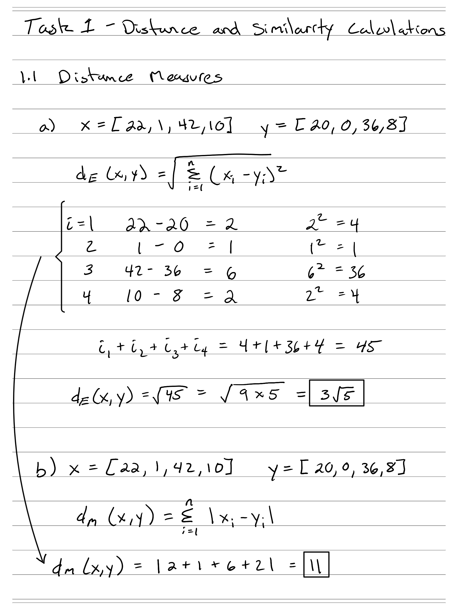
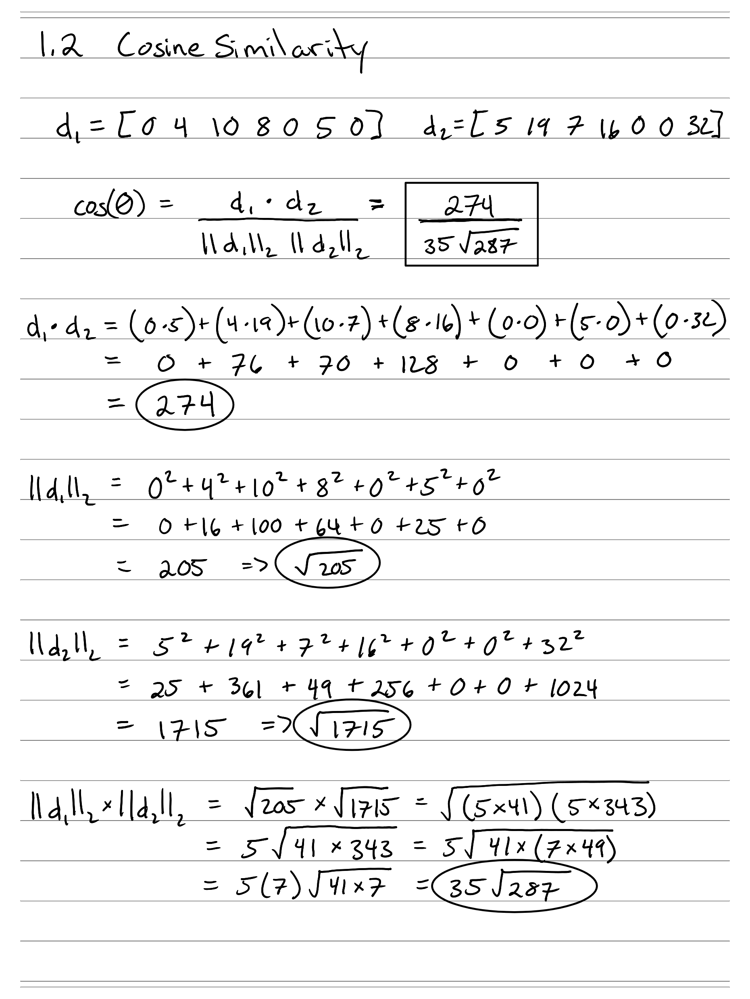
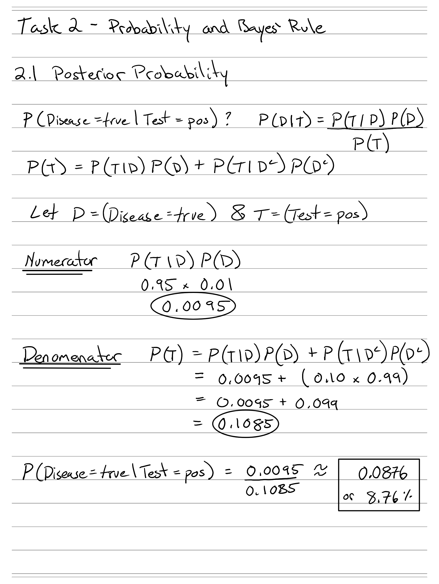
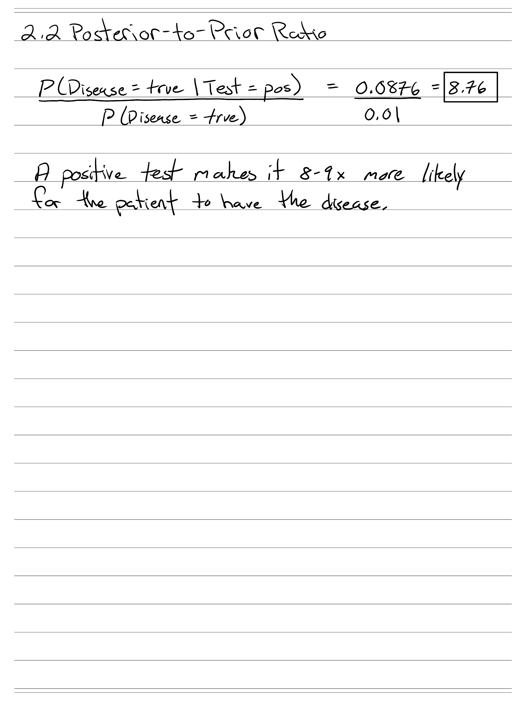

---
format:
  pdf:
    documentclass: article
    papersize: letter
    fontsize: 12pt
    geometry:
      - margin=1in
    include-in-header: preamble.tex
---

```{=latex}
% Fill these in once per assignment. They feed the first-page block,
% the running header (page 2 onward), and the footer.
% Name, last name, ID, and email are NOT set here. scripts/build-writeup.sh
% injects them at build time from .local/student.env, so they stay out of git.
\newcommand{\courseName}{CSS 581: Machine Learning}
\newcommand{\dueDate}{November 13, 2026}
\newcommand{\asgTitle}{Assignment 2: Distance, Probability, and PCA}
\newcommand{\codeRepo}{\url{https://github.com/GameAnimeCode/css581-machine-learning}}

\thispagestyle{firstpage}
\noindent \stuName \hfill \courseName \\
\stuId{} | \stuEmail \hfill \dueDate

\bigskip
\begin{center}
{\Large\bfseries \asgTitle}
\end{center}
```

## Task 1: Distance and Similarity Calculations (10 points)

Complete this task by hand and show your steps.

### 1.1 Distance Measures (5 points)

Given the two objects $x = (22, 1, 42, 10)$ and $y = (20, 0, 36, 8)$, answer the following.

#### a. Euclidean Distance (3 points)

Compute the Euclidean distance between the two vectors. Show substitution and simplification.

$$d_E(x, y) = \sqrt{\sum_{i=1}^{n} (x_i - y_i)^2}$$

**Answer:**

> $d_E(x, y) = \sqrt{45} = 3\sqrt{5} \approx 6.708$. The handwritten derivation is in the figure after part b.

#### b. Manhattan Distance (2 points)

Compute the Manhattan distance between the two vectors. Show substitution and simplification.

$$d_M(x, y) = \sum_{i=1}^{n} |x_i - y_i|$$

**Answer:**

> $d_M(x, y) = 2 + 1 + 6 + 2 = 11$.
>
> ```{=latex}
> \clearpage
> ```
>
> {width=6.25in}

### 1.2 Cosine Similarity (5 points)

Suppose the document-term matrix is:

| document | t1 | t2 | t3 | t4 | t5 | t6 | t7 |
|:--------:|---:|---:|---:|---:|---:|---:|---:|
| d1 | 0 | 4 | 10 | 8 | 0 | 5 | 0 |
| d2 | 5 | 19 | 7 | 16 | 0 | 0 | 32 |
| d3 | 15 | 0 | 0 | 4 | 9 | 0 | 17 |
| d4 | 22 | 3 | 12 | 0 | 5 | 15 | 0 |
| d5 | 0 | 7 | 0 | 9 | 2 | 4 | 12 |

Compute the cosine similarity between documents d1 and d2. Show the dot product, both vector norms, and the final similarity value. Use

$$\cos(\theta) = \frac{d_1 \cdot d_2}{\|d_1\|_2 \, \|d_2\|_2}.$$

**Answer:**

> $d_1 \cdot d_2 = 274$, $\|d_1\|_2 = \sqrt{205}$, and $\|d_2\|_2 = \sqrt{1715}$, so
>
> $$\cos(\theta) = \frac{274}{35\sqrt{287}} \approx 0.462.$$
>
> ```{=latex}
> \clearpage
> ```
>
> {width=6.25in}

## Task 2: Probability and Bayes' Rule (20 points)

A diagnostic test is used for a relatively rare disease. Let $\text{Test} \in \{\text{pos}, \text{neg}\}$ denote the test result and $\text{Disease} \in \{\text{true}, \text{false}\}$ denote disease status.

The following information is known:

| Quantity | Probability |
|:---------|:------------|
| Sensitivity / true-positive rate | $P(\text{Test} = \text{pos} \mid \text{Disease} = \text{true}) = 0.95$ |
| Specificity / true-negative rate | $P(\text{Test} = \text{neg} \mid \text{Disease} = \text{false}) = 0.90$ |
| False-positive rate | $P(\text{Test} = \text{pos} \mid \text{Disease} = \text{false}) = 0.10$ |
| Disease prevalence / prior | $P(\text{Disease} = \text{true}) = 0.01$ |
| No disease | $P(\text{Disease} = \text{false}) = 0.99$ |

### 2.1 Posterior Probability (18 points)

Use Bayes' rule to calculate the probability that the disease is present given a positive test: $P(\text{Disease} = \text{true} \mid \text{Test} = \text{pos})$. Show the numerator, the total probability of a positive test, and the final posterior probability. Use

$$P(D \mid T) = \frac{P(T \mid D)\,P(D)}{P(T)}, \quad \text{where} \quad P(T) = P(T \mid D)\,P(D) + P(T \mid D^c)\,P(D^c).$$

**Answer:**

> The numerator is $0.95 \times 0.01 = 0.0095$ and the total probability of a positive test is $P(T) = 0.0095 + 0.10 \times 0.99 = 0.1085$, so
>
> $$P(\text{Disease} = \text{true} \mid \text{Test} = \text{pos}) = \frac{0.0095}{0.1085} \approx 0.0876 = 8.76\%.$$
>
> ```{=latex}
> \clearpage
> ```
>
> {width=6.25in}

### 2.2 Posterior-to-Prior Ratio (2 points)

Calculate

$$\frac{P(\text{Disease} = \text{true} \mid \text{Test} = \text{pos})}{P(\text{Disease} = \text{true})}$$

and briefly interpret what the ratio says about how a positive test changes the prior belief.

**Answer:**

> The ratio is $0.0876 / 0.01 = 8.76$. A positive test makes it about 8 to 9 times more likely that the patient has the disease than the prior alone suggests.
>
> ```{=latex}
> \clearpage
> ```
>
> {width=6.25in}

## Task 3: PCA Simulation from Scratch in Python (25 points)

Let $X \in \mathbb{R}^{m \times n}$ be a data matrix with $m$ observations and $n$ features. Let $\mu$ be the feature-wise mean and define the centered matrix $X_c = X - \mathbf{1}\mu^T$. If $V_p \in \mathbb{R}^{n \times p}$ contains the eigenvectors associated with the largest $p$ eigenvalues, the PCA scores are $Z = X_c V_p$, and the reconstruction in the original feature space is $\hat{X} = Z V_p^T + \mathbf{1}\mu^T$.

### 3.1 Generate and Visualize Correlated 2D Data (2 points)

Generate 1,000 two-dimensional data points using the reproducible setup in the handout (seed 581, zero mean, covariance $\begin{bmatrix} 2.0 & 1.4 \\ 1.4 & 1.0 \end{bmatrix}$) and display them as Figure 1, a scatter plot of the original $x_1$ and $x_2$ values with equal axis scaling if practical.

**Answer:**

> answer

### 3.2 Compute the First Principal Component and Project the Data (10 points)

1. Compute the feature-wise mean and center $X$.
2. Compute the $2 \times 2$ sample covariance matrix $C = \frac{1}{m-1} X_c^T X_c$.
3. Compute the eigenvalues and eigenvectors of $C$.
4. Sort the eigenpairs from largest to smallest eigenvalue.
5. Select the eigenvector associated with the largest eigenvalue as the first principal component $v_1$.
6. Project every centered data point onto that component: $z_1 = X_c v_1$.
7. Report both eigenvalues and the percentage of total variance explained by PC1: $\text{Explained Variance Ratio}_1 = \frac{\lambda_1}{\lambda_1 + \lambda_2}$.
8. Create Figure 2 showing the one-dimensional PC1 scores. A scatter plot of PC1 score versus zero is acceptable.

**Answer:**

> answer

### 3.3 Reconstruct from One Principal Component (3 points)

Reconstruct the two-dimensional points using only PC1: $\hat{X} = z_1 v_1^T + \mathbf{1}\mu^T$. Create Figure 3 showing the reconstructed points in the original two-dimensional feature space.

**Answer:**

> answer

### 3.4 Short Report (10 points)

Your report should:

- explain each PCA step in your own words;
- include Figures 1 to 3 and the key numerical results;
- explain what information is lost when reducing from two dimensions to one; and
- discuss how the direction of PC1 relates to the shape and orientation of the original point cloud.

**Answer:**

> answer

## Task 4: PCA on USPS Handwritten Digits in Python (45 points)

Apply your PCA implementation to the provided `USPS.npz` dataset. The file contains `images`, a $3000 \times 256$ array representing 3,000 flattened $16 \times 16$ digit images, and `labels`, a length-3000 array containing the digit label (0 to 9) for each image.

### 4.1 Load and Inspect the Data

Load the dataset with NumPy. Preprocess by computing the mean image (feature-wise mean across all 3,000 samples) and centering the image matrix. Do not independently standardize every pixel unless you explicitly justify that choice in your report.

**Answer:**

> answer

### 4.2 Implement PCA and Reconstruction (20 points)

Using your own PCA implementation:

1. Fit PCA to the centered USPS image data.
2. Use $p \in \{10, 50, 100, 150, 200\}$ principal components.
3. For each requested $p$, form $V_p$ from the first $p$ eigenvectors and calculate $Z_p = (A - \mathbf{1}\mu^T) V_p$, then reconstruct the data with $\hat{A}_p = Z_p V_p^T + \mathbf{1}\mu^T$.

Organize your code into functions where practical (for example, `fit_pca`, `project_pca`, and `reconstruct_pca`). Because the dataset has only 256 features, a $256 \times 256$ covariance matrix is manageable; `np.linalg.eigh` is appropriate for the symmetric covariance matrix.

**Answer:**

> answer

### 4.3 Visual Comparison of Original and Reconstructed Images (10 points)

Use the last two images in the dataset (`A[-2]` and `A[-1]`). For each image, show the original plus its reconstructions for $p = 10, 50, 100, 150, 200$. A clear layout is one row per original image and six columns: Original, $p = 10$, $p = 50$, $p = 100$, $p = 150$, $p = 200$. Include the digit label in the row title or figure caption.

**Answer:**

> answer

### 4.4 Reconstruction Error (10 points)

For each $p \in \{10, 50, 100, 150, 200\}$, calculate the mean squared reconstruction error over the complete dataset:

$$\mathrm{MSE}(A, \hat{A}_p) = \frac{1}{3000 \cdot 256} \sum_{i=1}^{3000} \sum_{j=1}^{256} \left(A_{ij} - \hat{A}_{p,ij}\right)^2.$$

Report the five MSE values in a table and explain the trend as $p$ increases. A line plot of MSE versus $p$ is encouraged but not required.

**Answer:**

> answer

### 4.5 Discussion (5 points)

Address the following questions:

- How does visual image quality change as more components are retained?
- How does the reconstruction error change, and why?
- At approximately what value of $p$ do you observe diminishing visual returns?
- What does this experiment suggest about dimensionality reduction and redundancy in image data?

**Answer:**

> answer
