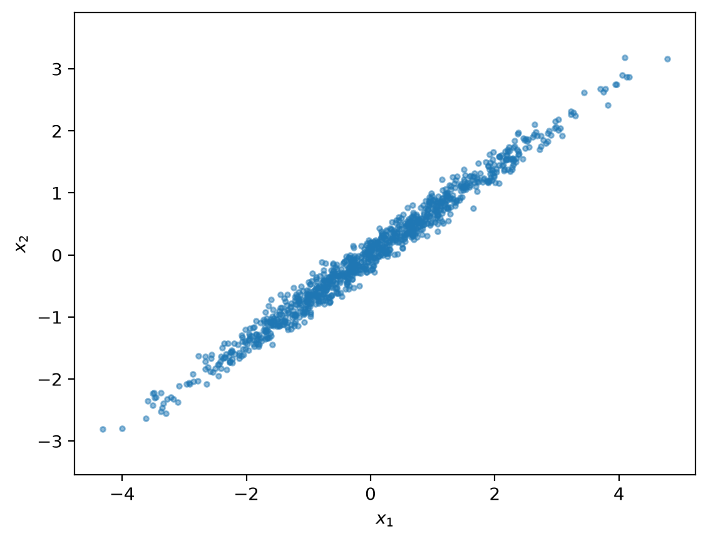
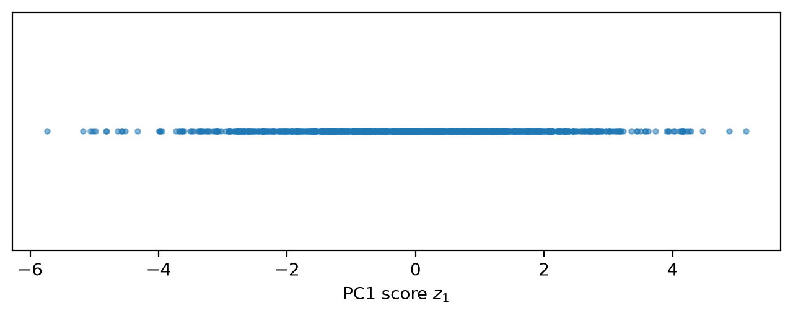
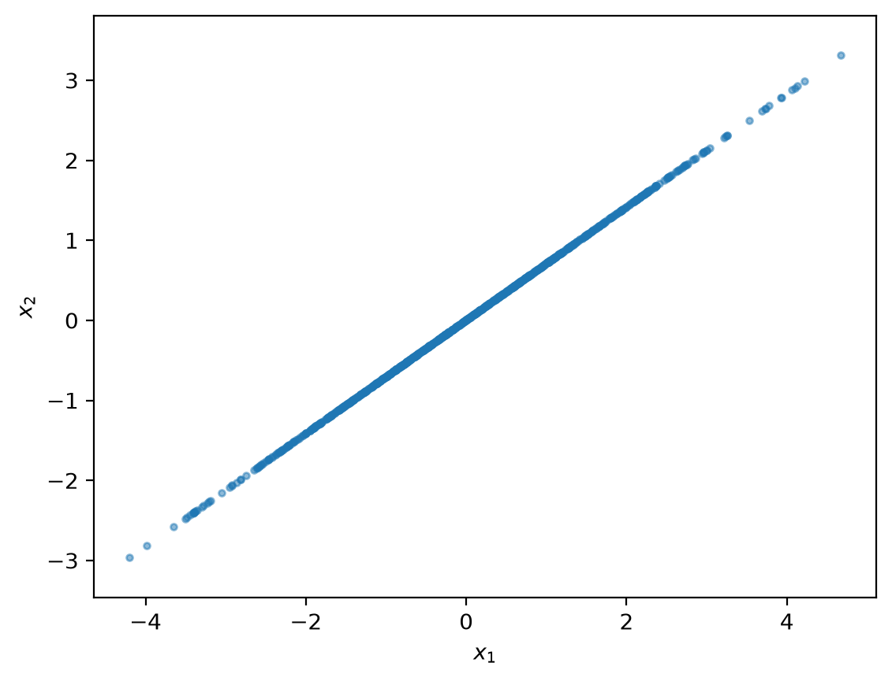
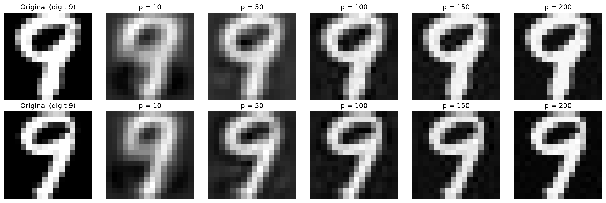
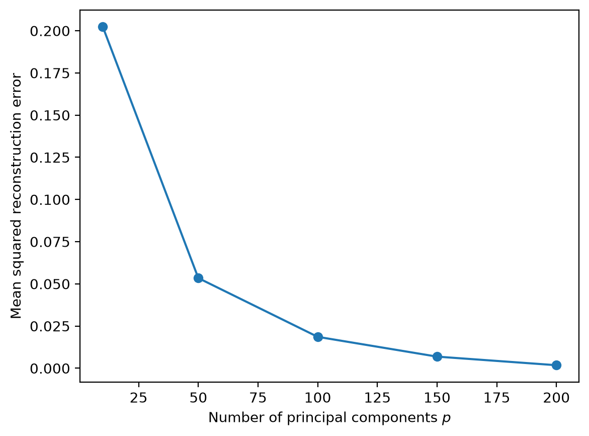

---
filters:
  - quarto
  - ../../filters/crossref-link.lua
format:
  pdf:
    documentclass: article
    papersize: letter
    fontsize: 12pt
    geometry:
      - margin=1in
    include-in-header: preamble.tex
---

```{=latex}
% Fill these in once per assignment. They feed the first-page block,
% the running header (page 2 onward), and the footer.
% Name, last name, ID, and email are NOT set here. scripts/build-writeup.sh
% injects them at build time from .local/student.env, so they stay out of git.
\newcommand{\courseName}{CSS 581: Machine Learning}
\newcommand{\dueDate}{November 13, 2026}
\newcommand{\asgTitle}{Assignment 2: Distance, Probability, and PCA}
\newcommand{\codeRepo}{\url{https://github.com/GameAnimeCode/css581-machine-learning}}

\thispagestyle{firstpage}
\noindent \stuName \hfill \courseName \\
\stuId{} | \stuEmail \hfill \dueDate

\bigskip
\begin{center}
{\Large\bfseries \asgTitle}
\end{center}
```

## Task 1: Distance and Similarity Calculations (10 points)

Complete this task by hand and show your steps.

### 1.1 Distance Measures (5 points)

Given the two objects $x = (22, 1, 42, 10)$ and $y = (20, 0, 36, 8)$, answer the following.

#### a. Euclidean Distance (3 points)

Compute the Euclidean distance between the two vectors. Show substitution and simplification.

$$d_E(x, y) = \sqrt{\sum_{i=1}^{n} (x_i - y_i)^2}$$

**Answer:**

> $d_E(x, y) = \sqrt{45} = 3\sqrt{5} \approx 6.708$. The handwritten derivation is in @fig-task-1-1.

#### b. Manhattan Distance (2 points)

Compute the Manhattan distance between the two vectors. Show substitution and simplification.

$$d_M(x, y) = \sum_{i=1}^{n} |x_i - y_i|$$

**Answer:**

> $d_M(x, y) = 2 + 1 + 6 + 2 = 11$.
>
> ```{=latex}
> \clearpage
> ```
>
> {#fig-task-1-1 width=6.25in}

### 1.2 Cosine Similarity (5 points)

Suppose the document-term matrix is:

| document | t1 | t2 | t3 | t4 | t5 | t6 | t7 |
|:--------:|---:|---:|---:|---:|---:|---:|---:|
| d1 | 0 | 4 | 10 | 8 | 0 | 5 | 0 |
| d2 | 5 | 19 | 7 | 16 | 0 | 0 | 32 |
| d3 | 15 | 0 | 0 | 4 | 9 | 0 | 17 |
| d4 | 22 | 3 | 12 | 0 | 5 | 15 | 0 |
| d5 | 0 | 7 | 0 | 9 | 2 | 4 | 12 |

Compute the cosine similarity between documents d1 and d2. Show the dot product, both vector norms, and the final similarity value. Use

$$\cos(\theta) = \frac{d_1 \cdot d_2}{\|d_1\|_2 \, \|d_2\|_2}.$$

**Answer:**

> $d_1 \cdot d_2 = 274$, $\|d_1\|_2 = \sqrt{205}$, and $\|d_2\|_2 = \sqrt{1715}$, so
>
> $$\cos(\theta) = \frac{274}{35\sqrt{287}} \approx 0.462.$$
>
> ```{=latex}
> \clearpage
> ```
>
> {#fig-task-1-2 width=6.25in}

## Task 2: Probability and Bayes' Rule (20 points)

A diagnostic test is used for a relatively rare disease. Let $\text{Test} \in \{\text{pos}, \text{neg}\}$ denote the test result and $\text{Disease} \in \{\text{true}, \text{false}\}$ denote disease status.

The following information is known:

| Quantity | Probability |
|:---------|:------------|
| Sensitivity / true-positive rate | $P(\text{Test} = \text{pos} \mid \text{Disease} = \text{true}) = 0.95$ |
| Specificity / true-negative rate | $P(\text{Test} = \text{neg} \mid \text{Disease} = \text{false}) = 0.90$ |
| False-positive rate | $P(\text{Test} = \text{pos} \mid \text{Disease} = \text{false}) = 0.10$ |
| Disease prevalence / prior | $P(\text{Disease} = \text{true}) = 0.01$ |
| No disease | $P(\text{Disease} = \text{false}) = 0.99$ |

### 2.1 Posterior Probability (18 points)

Use Bayes' rule to calculate the probability that the disease is present given a positive test: $P(\text{Disease} = \text{true} \mid \text{Test} = \text{pos})$. Show the numerator, the total probability of a positive test, and the final posterior probability. Use

$$P(D \mid T) = \frac{P(T \mid D)\,P(D)}{P(T)}, \quad \text{where} \quad P(T) = P(T \mid D)\,P(D) + P(T \mid D^c)\,P(D^c).$$

**Answer:**

> The numerator is $0.95 \times 0.01 = 0.0095$ and the total probability of a positive test is $P(T) = 0.0095 + 0.10 \times 0.99 = 0.1085$, so
>
> $$P(\text{Disease} = \text{true} \mid \text{Test} = \text{pos}) = \frac{0.0095}{0.1085} \approx 0.0876 = 8.76\%.$$
>
> ```{=latex}
> \clearpage
> ```
>
> {#fig-task-2-1 width=6.25in}

### 2.2 Posterior-to-Prior Ratio (2 points)

Calculate

$$\frac{P(\text{Disease} = \text{true} \mid \text{Test} = \text{pos})}{P(\text{Disease} = \text{true})}$$

and briefly interpret what the ratio says about how a positive test changes the prior belief.

**Answer:**

> The ratio is $0.0876 / 0.01 = 8.76$. A positive test makes it about 8 to 9 times more likely that the patient has the disease than the prior alone suggests.
>
> ```{=latex}
> \clearpage
> ```
>
> {#fig-task-2-2 width=6.25in}

## Task 3: PCA Simulation from Scratch in Python (25 points)

Let $X \in \mathbb{R}^{m \times n}$ be a data matrix with $m$ observations and $n$ features. Let $\mu$ be the feature-wise mean and define the centered matrix $X_c = X - \mathbf{1}\mu^T$. If $V_p \in \mathbb{R}^{n \times p}$ contains the eigenvectors associated with the largest $p$ eigenvalues, the PCA scores are $Z = X_c V_p$, and the reconstruction in the original feature space is $\hat{X} = Z V_p^T + \mathbf{1}\mu^T$.

### 3.1 Generate and Visualize Correlated 2D Data (2 points)

Generate 1,000 two-dimensional data points using the reproducible setup in the handout (seed 581, zero mean, covariance $\begin{bmatrix} 2.0 & 1.4 \\ 1.4 & 1.0 \end{bmatrix}$) and display them as @fig-original, a scatter plot of the original $x_1$ and $x_2$ values with equal axis scaling if practical.

**Answer:**

> The 1,000 points come from `generate_data()` (seed 581, mean $(0, 0)$, covariance $\begin{bmatrix} 2.0 & 1.4 \\ 1.4 & 1.0 \end{bmatrix}$). The first column of `X` is the horizontal value and the second column is the vertical value, and `plt.axis("equal")` keeps one unit the same length on both axes. The cloud is a long, thin band rising from the lower left to the upper right, so $x_1$ and $x_2$ are strongly and positively correlated.
>
> {#fig-original width=70%}

### 3.2 Compute the First Principal Component and Project the Data (10 points)

1. Compute the feature-wise mean and center $X$.
2. Compute the $2 \times 2$ sample covariance matrix $C = \frac{1}{m-1} X_c^T X_c$.
3. Compute the eigenvalues and eigenvectors of $C$.
4. Sort the eigenpairs from largest to smallest eigenvalue.
5. Select the eigenvector associated with the largest eigenvalue as the first principal component $v_1$.
6. Project every centered data point onto that component: $z_1 = X_c v_1$.
7. Report both eigenvalues and the percentage of total variance explained by PC1: $\text{Explained Variance Ratio}_1 = \frac{\lambda_1}{\lambda_1 + \lambda_2}$.
8. Create @fig-pc1-scores showing the one-dimensional PC1 scores. A scatter plot of PC1 score versus zero is acceptable.

**Answer:**

> 1. **Mean and centering.** The feature-wise mean is $\mu = (-0.0049, 0.0010)$, from `np.mean(X, axis=0)`. Subtracting it moves the cloud onto the origin so the variance calculations are anchored there, without changing the shape of the data.
> 2. **Covariance.** `np.cov(X_c, rowvar=False)` gives the $2 \times 2$ matrix of the variance of $x_1$, the covariance of $x_1$ and $x_2$, and the variance of $x_2$:
>
>     $$C = \begin{bmatrix} 2.0730 & 1.4579 \\ 1.4579 & 1.0453 \end{bmatrix}$$
>
> 3. **Eigendecomposition.** The eigenvectors give the directions of stretch and the eigenvalues give the amount of stretch in each direction. Because $C$ is symmetric I used `np.linalg.eigh`.
> 4. **Sorting.** `eigh` returns the eigenvalues smallest first, so I reversed them. The sorted eigenvalues are $\lambda_1 = 3.1050$ and $\lambda_2 = 0.0134$.
> 5. **PC1.** The eigenvector for the largest eigenvalue is $v_1 = (-0.8162, -0.5777)^T$, the direction of maximum stretch. The other eigenvector, $v_2 = (0.5777, -0.8162)^T$, is perpendicular to it.
> 6. **Projection.** $z_1 = X_c v_1$ turns each centered point into one number, its position along PC1.
> 7. **Explained variance.** $$\text{EVR}_1 = \frac{\lambda_1}{\lambda_1 + \lambda_2} = \frac{3.1050}{3.1050 + 0.0134} = 99.57\%.$$
> 8. @fig-pc1-scores shows the 1D scores. Each point has only one coordinate, so every point is plotted at zero on the vertical axis, which carries no information.
>
> {#fig-pc1-scores width=80%}

### 3.3 Reconstruct from One Principal Component (3 points)

Reconstruct the two-dimensional points using only PC1: $\hat{X} = z_1 v_1^T + \mathbf{1}\mu^T$. Create @fig-reconstruction showing the reconstructed points in the original two-dimensional feature space.

**Answer:**

> Multiplying each 1D score by the 2D direction of PC1, $z_1 v_1^T$ (`np.outer`), puts every point back on the PC1 line through the origin. Adding the original mean $\mu$ moves that line back to where the data was. Every reconstructed point lies exactly on one line, and the mean squared error against the original data is 0.0067.
>
> {#fig-reconstruction width=70%}

### 3.4 Short Report (10 points)

Your report should:

- explain each PCA step in your own words;
- include Figures 1 to 3 and the key numerical results;
- explain what information is lost when reducing from two dimensions to one; and
- discuss how the direction of PC1 relates to the shape and orientation of the original point cloud.

**Answer:**

> **The steps.** First I center the data by subtracting the mean, so the cloud sits on the origin and the variance calculations are anchored there without changing the shape of the data. Next I build the covariance matrix, which records how much each feature varies and how the two features vary together. Its eigenvectors are the directions of stretch of the cloud and its eigenvalues are the amount of stretch along each one. I sort them from largest to smallest and keep the eigenvector with the largest eigenvalue as PC1, the direction of maximum variance. Projecting the centered points onto PC1 gives each point a single score. To reconstruct, I multiply each score by the PC1 direction to place it back in two dimensions and add the mean back.
>
> **Key results.** $\lambda_1 = 3.1050$, $\lambda_2 = 0.0134$, and PC1 explains 99.57% of the total variance. The reconstruction error is 0.0067. @fig-original, @fig-pc1-scores, and @fig-reconstruction are shown in the answers above.
>
> **What is lost.** Going from two dimensions to one trades a dimension of the data for compression. I keep the direction with the most variance and discard the direction with the least. After reconstruction every point sits exactly on the PC1 line, so each point's offset perpendicular to the line, its PC2 coordinate, is gone and cannot be recovered. Only 0.43% of the variance is discarded, so the loss is small here, and it is the thin scatter around the line in @fig-original. This is what lets PCA compress the data to a smaller size while keeping as much valuable information as possible.
>
> **PC1 and the shape of the cloud.** The cloud in @fig-original is an elongated band tilted upward to the right, because $x_1$ and $x_2$ have a large positive covariance (1.46). PC1 points along the long axis of that band, at about 35° above the $x_1$ axis. The sign of the eigenvector is arbitrary, which is why $v_1$ points toward the lower left, but the line it defines is the same. PC2 is perpendicular to PC1 and runs across the narrow width of the band. The large gap between $\lambda_1$ and $\lambda_2$ matches how stretched the cloud is, and it is why the one-dimensional reconstruction in @fig-reconstruction looks so much like the original.

## Task 4: PCA on USPS Handwritten Digits in Python (45 points)

Apply your PCA implementation to the provided `USPS.npz` dataset. The file contains `images`, a $3000 \times 256$ array representing 3,000 flattened $16 \times 16$ digit images, and `labels`, a length-3000 array containing the digit label (0 to 9) for each image.

### 4.1 Load and Inspect the Data

Load the dataset with NumPy. Preprocess by computing the mean image (feature-wise mean across all 3,000 samples) and centering the image matrix. Do not independently standardize every pixel unless you explicitly justify that choice in your report.

**Answer:**

> `np.load` gives `images` with shape $(3000, 256)$ and `labels` with shape $(3000,)$. Pixel values run from 0.0 to 2.0, and the mean image has an average pixel value of 0.5116. I center with `A - np.mean(A, axis=0)`, which subtracts the mean image from every sample. Centering happens inside `fit_pca`, and `project_pca` repeats it, so the raw data is never modified.
>
> I did not standardize each pixel. Every pixel is already on the same 0 to 2 scale, so standardizing would add nothing. It would also hurt: the per-pixel standard deviation ranges from 0.0496 (nearly always empty border pixels) to 0.8948 (pixels the digit often crosses). Dividing by those values would inflate the border pixels to the same weight as the strokes, and PCA would then spend components on noise instead of digit shape.

### 4.2 Implement PCA and Reconstruction (20 points)

Using your own PCA implementation:

1. Fit PCA to the centered USPS image data.
2. Use $p \in \{10, 50, 100, 150, 200\}$ principal components.
3. For each requested $p$, form $V_p$ from the first $p$ eigenvectors and calculate $Z_p = (A - \mathbf{1}\mu^T) V_p$, then reconstruct the data with $\hat{A}_p = Z_p V_p^T + \mathbf{1}\mu^T$.

Organize your code into functions where practical (for example, `fit_pca`, `project_pca`, and `reconstruct_pca`). Because the dataset has only 256 features, a $256 \times 256$ covariance matrix is manageable; `np.linalg.eigh` is appropriate for the symmetric covariance matrix.

**Answer:**

> The implementation is in `src/pca.py`, with `fit_pca`, `project_pca`, and `reconstruct_pca` shared with Task 3. `fit_pca` computes the mean image, centers $A$, builds the $256 \times 256$ covariance with `np.cov(A_c, rowvar=False)`, and runs `np.linalg.eigh`. Because `eigh` returns the eigenvalues smallest first, I reverse both the eigenvalues and the eigenvector columns so the largest is in front. The total variance (the sum of all 256 eigenvalues) is 119.6239.
>
> For each $p \in \{10, 50, 100, 150, 200\}$ I slice $V_p$ as the first $p$ eigenvector columns, `eigenvectors[:, :p]`, then compute $Z_p = (A - \mathbf{1}\mu^T) V_p$ with `np.dot` and reconstruct with $\hat{A}_p = Z_p V_p^T + \mathbf{1}\mu^T$. The first $p$ components keep 56.70%, 88.56%, 96.02%, 98.53%, and 99.62% of the total variance, respectively.

### 4.3 Visual Comparison of Original and Reconstructed Images (10 points)

Use the last two images in the dataset (`A[-2]` and `A[-1]`). For each image, show the original plus its reconstructions for $p = 10, 50, 100, 150, 200$. A clear layout is one row per original image and six columns: Original, $p = 10$, $p = 50$, $p = 100$, $p = 150$, $p = 200$. Include the digit label in the row title or figure caption.

**Answer:**

> @fig-usps-comparison shows the last two images in the dataset. Both are labeled 9, so each row is titled "Original (digit 9)". The first column is the original and the other five are the reconstructions for $p = 10, 50, 100, 150, 200$. I plot each 256-value row with `reshape(16, 16)` and no transpose, since this data already has the digit upright.
>
> {#fig-usps-comparison width=100%}

### 4.4 Reconstruction Error (10 points)

For each $p \in \{10, 50, 100, 150, 200\}$, calculate the mean squared reconstruction error over the complete dataset:

$$\mathrm{MSE}(A, \hat{A}_p) = \frac{1}{3000 \cdot 256} \sum_{i=1}^{3000} \sum_{j=1}^{256} \left(A_{ij} - \hat{A}_{p,ij}\right)^2.$$

Report the five MSE values in a table and explain the trend as $p$ increases. A line plot of MSE versus $p$ is encouraged but not required.

**Answer:**

> I compute the error with `np.mean((A - A_reconstructed) ** 2)`, which averages the squared difference over all $3000 \times 256$ entries. @tbl-usps-mse lists the five values, and @fig-usps-mse plots them.
>
> | $p$ | MSE | Change from previous $p$ | Variance kept |
> |----:|-------:|------:|-------:|
> | 10  | 0.2023 |       | 56.70% |
> | 50  | 0.0534 | $-0.1489$ | 88.56% |
> | 100 | 0.0186 | $-0.0348$ | 96.02% |
> | 150 | 0.0069 | $-0.0117$ | 98.53% |
> | 200 | 0.0018 | $-0.0051$ | 99.62% |
>
> : Mean squared reconstruction error on all 3,000 images. {#tbl-usps-mse}
>
> The error falls every time $p$ grows, and the drops get smaller. The first 40 added components cut the error by 0.1489, while the last 50 cut it by only 0.0051. The reason is that the eigenvalues are sorted from largest to smallest, so each new component carries less variance than the one before it. The MSE is exactly the variance that was thrown away. As a check, the sum of the discarded eigenvalues $\lambda_{p+1} + \dots + \lambda_{256}$, multiplied by $\frac{m-1}{m}$ (because `np.cov` divides by $m - 1$) and divided by 256, matches every MSE in the table to four decimals, so the "Check" column in the console output agrees with the table.
>
> {#fig-usps-mse width=70%}

### 4.5 Discussion (5 points)

Address the following questions:

- How does visual image quality change as more components are retained?
- How does the reconstruction error change, and why?
- At approximately what value of $p$ do you observe diminishing visual returns?
- What does this experiment suggest about dimensionality reduction and redundancy in image data?

**Answer:**

> **Image quality.** At $p = 10$ the digit is recognizable as a 9 but blurry, with a grey halo in the background and a smeared hole in the loop. At $p = 50$ the loop and the stem are clear and the edges are only slightly soft. By $p = 100$ the reconstruction is close to the original, and at $p = 150$ and $p = 200$ the remaining differences are faint grey speckle in the background.
>
> **Error.** The MSE drops from 0.2023 at $p = 10$ to 0.0018 at $p = 200$, with smaller gains each time. Each component adds less variance than the one before it, so the discarded variance, which is the MSE, shrinks more slowly as $p$ grows.
>
> **Diminishing returns.** I see them at about $p = 100$. Going from 50 to 100 components still cleans up the image noticeably (the variance kept rises from 88.56% to 96.02%), but going from 100 to 200 changes little to the eye even though it doubles the number of components. For reference, 56 components keep 90% of the variance, 89 keep 95%, and 167 keep 99%.
>
> **Dimensionality and redundancy.** The 256 pixels are far from independent. Neighboring pixels move together and many pixels near the border are almost always empty. PCA filters out that background and captures the core of the data, the shape of the digit, using only a fraction of the original data: 100 numbers per image instead of 256 keep 96% of the variance. This is the same trade as in Task 3, where I gave up the low-variance direction to compress the data while keeping as much valuable information as possible.
